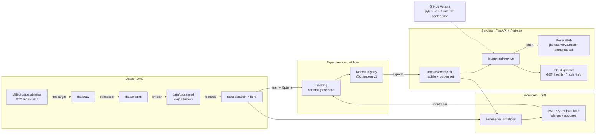

# Arquitectura de la solución (pipeline de MLOps)

| Componente | Herramienta | Archivos |
|---|---|---|
| Estructura del proyecto | Cookiecutter Data Science v2 | árbol del repositorio |
| Parámetros | `params.yaml` (fuente única) | `tc5044_mlops/config.py` |
| Versionado de datos y pipeline | DVC (remoto local) + Git | `dvc.yaml`, `dvc.lock` |
| Experimentos y registro de modelos | MLflow 3 (Tracking + Model Registry) | `tracking.py`, `modeling/train.py` |
| Orquestación | Makefile, DVC y MLflow Projects | `Makefile`, `MLproject` |
| Pruebas | pytest (unitarias + integración) | `tests/` |
| Servicio | FastAPI + Pydantic + uvicorn | `tc5044_mlops/api/` |
| Empaquetado | Podman / Docker (`python:3.11-slim`) | `Dockerfile`, `requirements-serving.txt` |
| Registro de imágenes | DockerHub | `jhonatan0925/mibici-demanda-api` |
| Reproducibilidad | golden set + re-entrenamiento con semilla | `reproducibilidad.py`, `verificar_servicio.py` |
| Monitoreo de drift | PSI/KS propios + Evidently | `tc5044_mlops/monitoring/` |
| Integración continua | GitHub Actions | `.github/workflows/ci.yml` |
