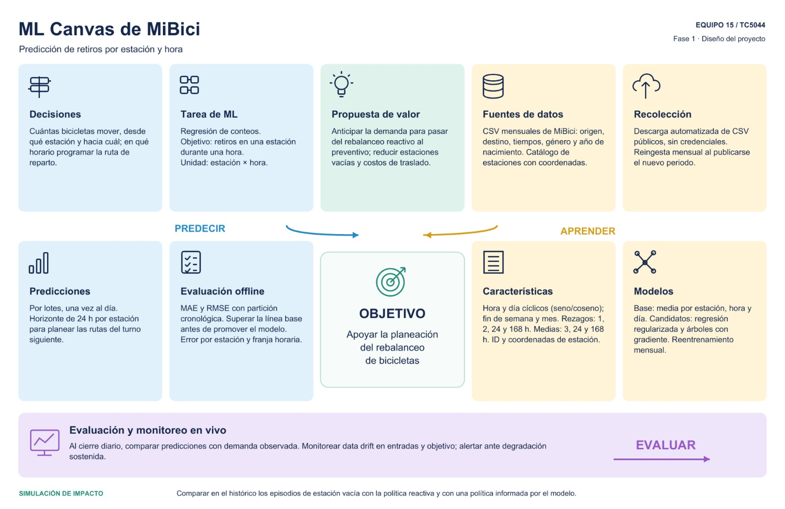

# ML Canvas — Predicción de demanda MiBici

**TC5044 Operaciones de aprendizaje automático · Equipo 15 · versión final (Fase 3)**

Estructura del Machine Learning Canvas de Dorard (2015), con los 11 bloques. La Fase 1 llenó
la propuesta de valor, las decisiones, la tarea, las fuentes y la recolección; la Fase 3 completa
los bloques de modelado, predicción, evaluación y monitoreo con lo que se construyó.

## 1. Propuesta de valor

Para el operador de MiBici (Guadalajara), anticipar cuántas bicicletas se retirarán de cada
estación en la próxima hora, de modo que el rebalanceo pase de **reactivo** (mover bicicletas
cuando la estación ya está vacía) a **preventivo**. Beneficios esperados: menos episodios de
estación vacía, menos traslados innecesarios y un servicio más confiable para el usuario.

## 2. Decisiones

Cada hora el coordinador del turno decide qué estaciones reabastecer y en qué orden recorrerlas.
El servicio devuelve, para las 50 estaciones de mayor demanda, los retiros esperados en la hora
siguiente; las estaciones con demanda prevista mayor que su inventario entran primero a la ruta.

*Ajuste respecto de la Fase 1:* el canvas inicial planteaba un lote diario con horizonte de 24 h,
pero el modelo usa la demanda de la hora anterior (rezagos de 1 y 2 h), así que su horizonte real
es de **1 hora** y se sirve en línea. Un modelo de 24 h (solo rezagos ≥ 24 h) queda como trabajo
futuro para la planeación del día siguiente.

## 3. Tarea de predicción

Regresión sobre conteos. Unidad de observación: estación × hora. Entrada: estación, fecha-hora
y demanda reciente de la estación. Salida: número esperado de retiros en esa hora (≥ 0).
Alcance: las 50 estaciones con más salidas (36.8 % de los viajes).

## 4. Fuentes de datos

Datos abiertos de MiBici (Instituto de Movilidad del Estado de Jalisco): un CSV mensual de viajes
(identificador, usuario anonimizado, género, año de nacimiento, inicio, fin, estación de origen y
de destino) y el catálogo de estaciones con coordenadas. Ventana usada: 2025-01 a 2026-08
(7 404 041 viajes, 613 MB); 2026-09 se reservó como conjunto de inferencia.

## 5. Recolección de datos

La fuente no tiene API ni descarga masiva: el script de ingesta (`dataset.py`) lee la página de
publicación para encontrar las URL, descarga de forma incremental con reintentos y escritura
atómica, y guarda un manifiesto con URL, tamaño y MD5. Las etapas descargar → consolidar →
limpiar → features → train → exportar → drift se versionan con DVC (`dvc.yaml`, `dvc.lock`).

## 6. Variables (features)

- Calendario cíclico: seno/coseno de hora, día de la semana y mes; fin de semana.
- Rezagos de la demanda: 1 h, 2 h, 24 h y 168 h; medias móviles de 3, 24 y 168 h, calculadas
  por estación y desplazadas una hora (sin fuga de información).
- Estación: `TargetEncoder` (demanda media suavizada, con *cross fitting*).
- Tipo de uso de la estación: 3 componentes PCA de su perfil horario (laborable y fin de semana).

## 7. Construcción de modelos

`Pipeline` de scikit-learn (imputación + escalado, `TargetEncoder`, PCA del perfil). Candidatos:
línea base estacional, Ridge, GLM Poisson, Random Forest y HistGradientBoosting con pérdida
Poisson, este último ajustado con Optuna (TPE, 30 intentos). Partición cronológica; selección por
MAE de validación. MLflow registra corridas, métricas, figuras y modelos; el Model Registry
asigna `@champion` (hgb_optuna, versión 1) y `@challenger`. Reentrenamiento: cuando el monitoreo
emite una alerta con acción `reentrenar` (`make train`, comparación contra `@champion`).

## 8. Evaluación offline

MAE (métrica de selección, en bicicletas/hora), RMSE, WAPE, devianza de Poisson y R².
Campeón: MAE 1.334 en validación (−32 % frente a la línea base) y 1.441 en prueba
(RMSE 2.34, WAPE 0.41, R² 0.74). Pruebas automatizadas (`pytest -q`) fijan la ausencia de
fuga temporal y la paridad entre el pipeline por lotes y el servicio.

## 9. Simulación de impacto

Criterio de despliegue: superar a la línea base estacional (la regla "misma hora de la semana
pasada" que puede aplicar el operador sin modelo) en validación y prueba. El campeón reduce el
error absoluto entre 0.5 y 0.6 bicicletas por estación-hora frente a esa regla (prueba y
validación): sumando las 50 estaciones, unas 25 a 30 bicicletas de error menos por hora en la
planeación de rutas. Un error por
defecto (subestimar) cuesta más que uno por exceso (estación vacía frente a un traslado de
sobra); un trabajo futuro es una pérdida asimétrica o cuantiles.

## 10. Hacer predicciones

Servicio en línea FastAPI (`POST /predict`, lote de 1 a 5 000 registros) empaquetado en una
imagen de contenedor (`docker.io/jhonatan0925/mibici-demanda-api`). Se invoca cada hora con las
50 estaciones; latencia de una predicción en el orden de decenas de milisegundos. El modelo que
sirve es `models:/mibici-demanda-estacion-hora/1`, exportado con su golden set para verificar
la reproducibilidad en cualquier entorno.

## 11. Monitoreo en vivo

- Entradas: PSI y KS por variable frente a validación, tasa de nulos y consistencia de los
  rezagos (el rezago de 1 h debe coincidir con la demanda observada una hora antes).
- Salidas: PSI de las predicciones (no requiere etiquetas).
- Desempeño: MAE frente a la línea base cuando llegan los retiros reales (una hora después).
- Umbrales (`params.yaml`, sección `drift`): PSI 0.1 aviso / 0.2 alerta; MAE +5 % aviso /
  +15 % alerta. Acciones: revisar el feature pipeline, reentrenar o vigilar
  (`python -m tc5044_mlops.monitoring.drift`, registrado en MLflow).

## Referencia

Dorard, L. (2015). *Machine Learning Canvas*. https://www.ownml.co/machine-learning-canvas
