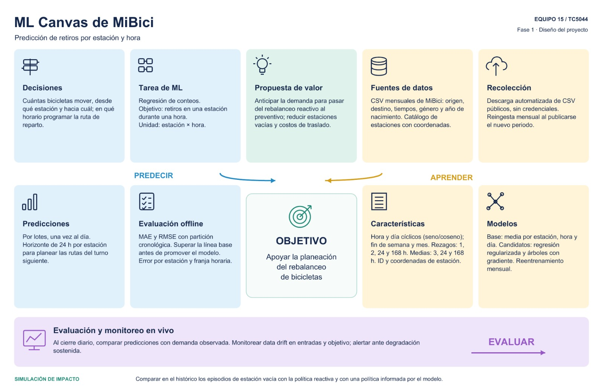

# ML Canvas — Predicción de demanda MiBici

**TC5044 Operaciones de aprendizaje automático · Equipo 15 · Fase 1**

Basado en la estructura del Machine Learning Canvas de Dorard (2015). El contenido de cada bloque
está resumido en el Cuadro 1 del documento de la Fase 1.

## Propuesta de valor

El proyecto pretende agregar valor anticipando la demanda de retiros considerando la estación y la hora del día con lo que el rebalanceo de bicicletas pasaría de ser reactivo (actuando cuando el desbalanceo ya ocurrio) a preventivo. Con esto buscamos reducir los episodios de estaciones vacias, el costo operativo de los traslados y finalmente que el usuario pueda usar más eficientemente el servicio.

## Decisiones

A partir de que el modelo sea generado se espera que el operador del sistema  decida cuantas bicicletas trasladar, desde que estación origen, hacia que estación destino y en que franja de horarios deberia de realizarse esta operación. Las predicciónes se generarían en batch una vez al día con un horizonte de 24 horas por estación con lo que se alimentaria la planeación de rutas del siguiente turno.

## Tarea de predicción

El tipo de problema que se abordaría es el de regresión sobre conteos ya que la salida es un número de bicicletas y no una alerta binaria. Por otro lado la variable objetivo sería el número de retiros  en una estación durante una hora en particular, mientras que la unidad de observación estaria dada por la combinación de estacion/hora.

## Fuentes de datos

El dataset usado proviene de los datos abiertos de MiBici, publicados por el Instituto de Movilidad y Transporte del Estado de Jalisco y contiene archivos csv mensuales de viajes con identificador del viaje, identificador de anonimizado del usuario, género, año de nacimiento, marcas de tiempo de inicio y fin, estación de retiro y estación de devolución. También contiene un catálogo de nomenclaturas de estaciones con coordenadas geográficas.

## Recolección de datos

¿Cómo se obtienen y con qué frecuencia se actualizan?

La fuente no ofrece un API ni descarga masiva, sólo publica un CSV por mes y la interfaz solo permite descargar un periodo a la vez. Debido a esto el script de ingesta encuentra las URL leyendo la pagina de publicación en lugar de intentar construirla basado en algun patrón. El script también agrega descarga incremental con reintentos, escritura atómica y tambien incluye un manifiesto que contiene la URL, el tamaño y el string MD5 para realizar una verificación de los archivos descargados.

## Referencia

Dorard, L. (2015). *Machine Learning Canvas*. https://www.ownml.co/machine-learning-canvas
